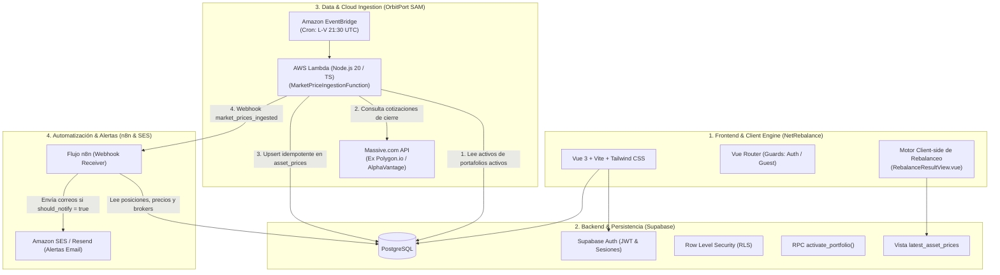

# NetRebalance & OrbitPort — Estado Actual del Sistema

**Fecha de actualización:** 25 de noviembre de 2026  
**Proyecto:** NetRebalance (Frontend & Motor de Rebalanceo) + OrbitPort SAM (Data & Cloud Ingestion)  
**Entorno de Datos:** Supabase (PostgreSQL, Auth, RLS, RPCs)

---

## 1. Resumen Ejecutivo y Arquitectura Global

El ecosistema **NetRebalance** es una plataforma orientada a la estrategia de inversión pasiva e indexada (*Core & Satellite*). Su objetivo principal es monitorear carteras de inversión, identificar desviaciones frente a asignaciones objetivo y determinar matemáticamente si un rebalanceo es rentable descontando las comisiones y spreads del intermediario bursátil.

El sistema se compone de tres capas arquitectónicas coordinadas:



---

## 2. Mapa de Módulos y Estado de Implementación

| Módulo | Responsable | Repositorio / Directorio | Stack Tecnológico | Estado Actual |
| :--- | :--- | :--- | :--- | :---: |
| **Frontend UI/UX & Motor Web** | Mafer | `net-rebalance/` | Vue 3, TypeScript, Vite, Tailwind CSS, Supabase JS | **100% Operativo** |
| **Base de Datos & Seguridad** | Andre | Supabase Remoto | PostgreSQL, Supabase Auth, RLS, Triggers, RPCs | **100% Operativo** |
| **Data & Cloud (Ingesta Precios)**| Jair | `OrbitPort Sam/` | AWS SAM, AWS Lambda, EventBridge, Massive API, TypeScript | **100% Implementado / Listo para Deploy** |
| **Orquestación & Alertas** | María | n8n externo | n8n Workflows, JavaScript, Amazon SES / Resend | **Contrato definido / En integración** |

---

## 3. Detalle de Componentes Funcionando

### 3.1. Frontend (`net-rebalance`)

El frontend está desarrollado en **Vue 3** con la Composition API (`<script setup lang="ts">`), navegación protegida mediante **Vue Router** y diseño responsivo con **Tailwind CSS**.

#### A. Módulo de Autenticación y Perfil
- **Vistas:** `LoginView.vue`, `RegisterView.vue`, `ProfileView.vue`.
- **Servicios:** `auth.service.ts`, `profile.service.ts`, composable reactivo `useAuth.ts`.
- **Funcionamiento:**
  - Registro de usuarios vía Supabase Auth (`signUp` con metadatos de nombre).
  - Inicio de sesión por correo y contraseña (`signInWithPassword`).
  - El trigger de base de datos `on_auth_user_created` crea automáticamente el registro en `public.profiles`.
  - Edición del nombre de perfil del usuario autenticado sincronizado en tiempo real.
  - Cierre de sesión seguro y protección de rutas privadas mediante guards de navegación.

#### B. Módulo de Gestión de Brokers (`BrokersView.vue`)
- **Servicio:** `broker.service.ts`.
- **Catálogo de Presets:** `src/constants/brokerPresets.ts`.
- **Funcionamiento:**
  - CRUD completo de brokers propios (filtrados automáticamente por RLS mediante `user_id = auth.uid()`).
  - **Selector inteligente de Brokers conocidos**:
    - **Brokers Nacionales (Perú / BVL - SABs autorizadas por la SMV):** *Trii Perú (Kallpa SAB)*, *Kallpa SAB*, *Renta 4 SAB Perú*, *Credicorp Capital SAB (BCP)*, *Inteligo SAB (Interbank)*, *Seminario y Cía SAB*.
    - **Brokers Internacionales (Wall Street / Global):** *Interactive Brokers (IBKR)*, *Hapi*, *Charles Schwab*, *eToro*, *Folionet*.
  - **Autollenado inteligente:** Al elegir un broker se precargan su divisa (`USD` o `PEN`), comisión fija referencial, comisión porcentual y spread estimado.
  - **Conversión matemática transparente:** En la interfaz se edita en porcentaje (ej. `0.50%`) y en la base de datos se almacena como fracción decimal (`0.005`) vía `toFractionDb()`, garantizando consistencia con las fórmulas financieras.
  - Eliminación segura de brokers con advertencia si están vinculados a carteras existentes.

#### C. Módulo de Gestión de Portafolios (`PortfoliosView.vue`)
- **Servicio:** `portfolio.service.ts`.
- **Funcionamiento:**
  - Listado de carteras con paginación, filtros de estado (`draft`, `active`, `all`) y buscador en tiempo real.
  - Indicadores clave por tarjeta/fila: Broker vinculado con badge de mercado (`🇵🇪 BVL` o `🌎 Int.`), moneda base, cantidad de activos asociados, suma de pesos configurados y estado de completitud.
  - Modal para creación de portafolios nuevos asignando un broker propio y heredando automáticamente su divisa.

#### D. Configuración de Activos y Pesos (`PortfolioConfigView.vue`)
- **Servicios:** `asset.service.ts`, `price.service.ts`, `portfolio.service.ts`.
- **Funcionamiento:**
  - Visualización del resumen de activos de la cartera con cálculo dinámico del valor monetario actual (`quantity × latest_price`) y pesos reales.
  - **Filtrado Inteligente de Activos:**
    - Detección de afinidad de mercado según el broker seleccionado (BVL vs. Mercados Globales).
    - Pestañas de filtrado rápido: `Todos`, `🇵🇪 BVL` y `🌎 EE.UU.`.
    - Filtro estricto por moneda del portafolio (evita inconsistencias de mezclar activos en Soles y Dólares).
    - Ficha técnica instantánea con último precio de cierre disponible y botón `"Usar precio actual"` para autocompletar el costo promedio de compra.
  - **Activación de Cartera:**
    - Validación en tiempo real de la regla de suma exacta al 100.00% de los pesos objetivo.
    - Ejecución de la función almacenada `activate_portfolio(p_portfolio_id)` en Supabase para transicionar formalmente el estado a `active`.

#### E. Motor de Análisis y Rebalanceo (`RebalanceResultView.vue`)
- **Funcionamiento:**
  - Ejecuta en cliente la lógica de análisis cuantitativo del portafolio activo.
  - Identifica la desviación absoluta de cada activo: `desviacion = peso_actual - peso_objetivo`.
  - Clasifica la acción recomendada por activo:
    - **Vender:** si el peso actual supera el objetivo.
    - **Comprar:** si el peso actual está por debajo del objetivo.
    - **Mantener:** si la desviación es insignificante.
  - **Estimación de Costos de Transacción:** Descuenta comisiones fijas, comisiones porcentuales y spread del broker configurado.
  - **Evaluación de Criterios del MVP:**
    1. *Desviación significativa:* Al menos un activo presenta una desviación absoluta $\ge 5\%$.
    2. *Costo aceptable:* El costo total estimado del rebalanceo no supera el $2\%$ del monto a redistribuir.
  - Emite el dictamen final: *"Se recomienda considerar el rebalanceo"* o *"No se recomienda realizar el rebalanceo en este momento"*.

#### F. Dashboard Principal (`DashboardView.vue`)
- **Funcionamiento:**
  - Selector de portafolios activos.
  - Tarjetas métricas de valor totalizado, rendimiento estimado, estado de precios y conteo de alertas.
  - Desglose visual de posiciones por activo.

---

### 3.2. Data & Cloud Ingestion (`OrbitPort Sam`)

Ubicado en `C:\Universidad\Agile\OrbitPort Sam`, es un servicio Serverless diseñado con **AWS SAM (Serverless Application Model)** para automatizar la obtención de cotizaciones financieras.

#### A. Arquitectura Serverless (`template.yaml`)
- **Función:** `MarketPriceIngestionFunction` (`orbitport-price-ingestion-*`).
- **Runtime:** Node.js 20.x sobre arquitectura x86_64, empaquetado y minificado con `esbuild` en formato ECMAScript moderno (`es2022`).
- **Configuración:** Timeout de 300 segundos, 512 MB de memoria RAM.
- **Trigger Automatizado:** Amazon EventBridge Rule con expresión cron:
  ```yaml
  Schedule: cron(30 21 ? * MON-FRI *)
  ```
  *(Se dispara de Lunes a Viernes a las 21:30 UTC, garantizando que Wall Street esté cerrado tanto en horario estándar EST como en horario de verano EDT).*

#### B. Pipeline de Ejecución (`src/index.ts`)
1. **Deduplicación de Activos (`src/services/db.service.ts`):**
   - Conexión a Supabase con rol administrativo `service_role` (omitiendo RLS).
   - Consulta `portfolio_assets` cruzando con `portfolios` (`status = 'active'`) y `assets` (`is_active = true`).
   - Deduplica los activos en memoria por `asset_id`. Si 10 portafolios usan `VOO`, se consulta la API de mercado una sola vez.
2. **Consulta a Proveedores Financieros (`src/services/market-data.service.ts`):**
   - Proveedor principal: **Massive.com API** (`api.massive.com` - rebrand oficial de Polygon.io) consultando el endpoint `/v2/aggs/ticker/{ticker}/prev`.
   - Proveedores alternativos soportados: **Polygon legacy** y **Alpha Vantage**.
   - Throttling y control de concurrencia (lotes de 4 llamadas con pausas de 150 ms para respetar límites de cuota).
   - Extracción de la fecha real de la sesión bursátil (`price_date`) entregada por el feed, nunca la hora del servidor.
   - Validación de precios mayores a cero y descarte de anomalías.
3. **Persistencia Idempotente:**
   - Inserción masiva en lotes de 100 registros en `public.asset_prices`.
   - Cláusula de idempotencia: `onConflict: 'asset_id,price_date,source'`. Permite reejecutar la Lambda el mismo día sin generar duplicados.
   - **Garantía de aislamiento:** La función nunca altera la tabla `assets`.
4. **Disparo de Webhook a n8n (`src/services/webhook.service.ts`):**
   - Envío de payload HTTP POST hacia `N8N_WEBHOOK_URL` con estructura:
     ```json
     {
       "event_type": "market_prices_ingested",
       "run_id": "uuid-v4",
       "price_date": "2026-11-25",
       "source": "massive",
       "status": "completed",
       "assets_expected": 8,
       "assets_updated": 8,
       "assets_failed": 0,
       "finished_at": "2026-11-25T21:35:12.450Z"
     }
     ```

---

### 3.3. Base de Datos y Persistencia (Supabase)

- **Instancia activa:** `https://qgcdnuoujlsdxblrdgqm.supabase.co`
- **Tablas y Vistas Operativas:**
  - `profiles`: Datos de usuario extendidos de `auth.users`.
  - `brokers`: Intermediarios registrados con comisiones y divisa.
  - `portfolios`: Portafolios vinculados a un broker y divisa base.
  - `portfolio_assets`: Ponderaciones objetivo (`target_weight`), cantidad de títulos y costo promedio.
  - `assets`: Catálogo maestro de activos (BVL y mercados internacionales).
  - `asset_prices`: Histórico de cotizaciones de cierre por activo, fecha y proveedor.
  - `latest_asset_prices`: Vista optimizada con `DISTINCT ON (asset_id)` para obtener el último precio vigente.
  - **Función RPC:** `activate_portfolio(p_portfolio_id)` para validar la suma del 100% y activar la cartera.

---

## 4. Estado de los Contratos de Integración (Docs)

### A. Contrato Mafer (Frontend ↔ Supabase)
- **Estado:** **100% Cumplido e Integrado.**
- Se cubrieron los flujos de autenticación, CRUD de brokers, CRUD de portafolios, selección y filtrado de activos, cálculo de valor de portafolios y visualización de recomendaciones de rebalanceo.

### B. Contrato Jair (Data & Cloud Ingestion)
- **Estado:** **100% Desarrollado en `OrbitPort Sam`.**
- Código TypeScript completo, probado y compilado (`npm run build` genera `dist/index.js` y `sam build` genera el artefacto en `.aws-sam`).
- Pendiente de despliegue final en la cuenta AWS mediante `sam deploy --guided`.

### C. Contrato María (n8n ↔ Alertas y Notificaciones)
- **Estado:** **En fase de orquestación externa.**
- La lógica matemática y los umbrales de decisión (`MIN_DEVIATION = 5%`, `MAX_COST_RATIO = 2%`) ya están completamente especificados y validados en el motor client-side (`RebalanceResultView.vue`).
- Falta configurar el webhook receptor en la instancia de n8n que consuma el payload de OrbitPort y ejecute el envío de correos vía Amazon SES / Resend.

---

## 5. Resumen de Brechas y Próximos Pasos

1. **Despliegue del SAM en AWS:**
   - Ejecutar `sam deploy --guided` en `OrbitPort Sam` configurando `SUPABASE_URL`, `SUPABASE_SECRET_KEY` y `MARKET_DATA_API_KEY`.
2. **Configuración del Webhook en n8n:**
   - Crear el workflow en n8n que escuche el evento `market_prices_ingested` emitido por la Lambda.
   - Replicar la lógica de evaluación implementada en `RebalanceResultView.vue` para notificar al usuario por correo si `should_notify = true`.
3. **Módulo de Alertas en Frontend (`AlertsView.vue`):**
   - Actualmente es un archivo base vacío; puede habilitarse en el futuro para consultar un historial de alertas emitidas si se crea la tabla correspondiente en Supabase.
